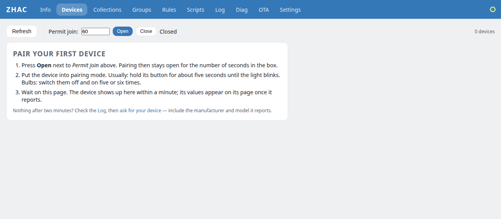
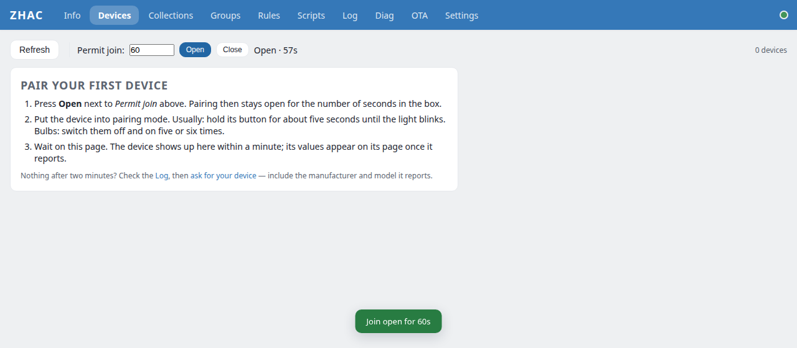
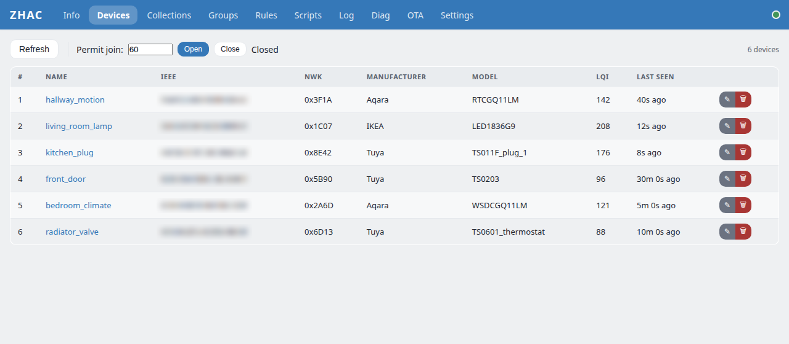
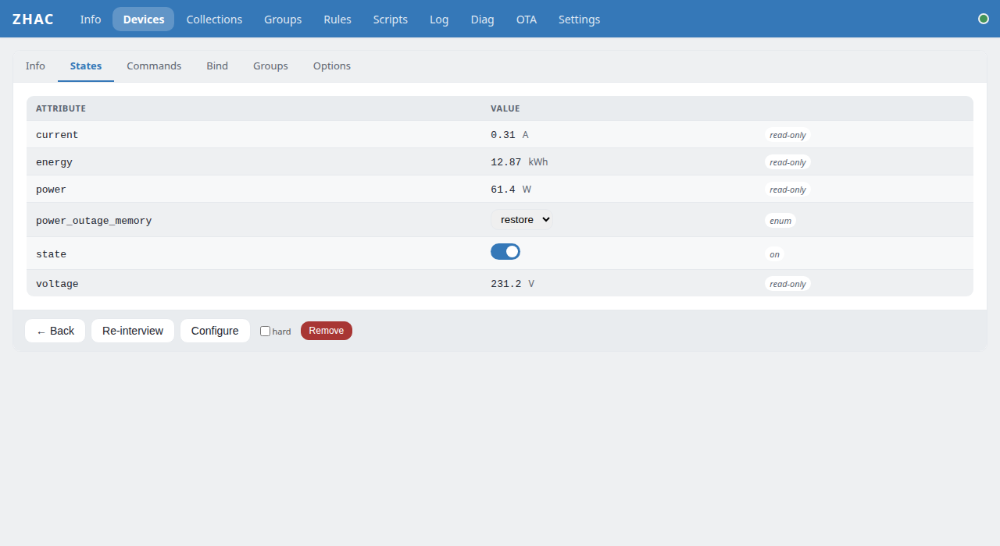
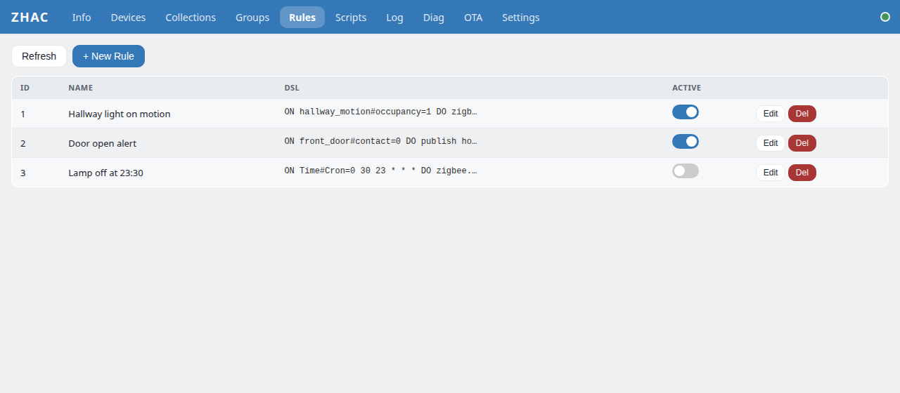

<!--
SPDX-FileCopyrightText: 2025-2026 Evgenij Cjura and project contributors
SPDX-License-Identifier: AGPL-3.0-or-later
-->

# Your first 20 minutes with ZHAC

From a bare board to a Zigbee sensor switching a lamp, without installing a toolchain.
ZHAC runs on one ESP32 board with an Ethernet jack: the **ESP32-S31 Function-CoreBoard**, or
an **ESP32-P4 board with an ESP32-C6** as its radio, such as the Guition JC-ESP32P4-M3-DEV.
Nothing here needs Wi-Fi setup, a Raspberry Pi or a cloud account.

> **Status, honestly.** Both boards run this firmware on hardware, and the maintainers' own
> hub is a P4 + C6 board. If a step below does not match what you see,
> [tell us](https://github.com/zhac-project/zhac-docs/issues/new?template=bug.yml); on a board not named here, a
> [board report](https://github.com/zhac-project/zhac-docs/issues/new?template=board-report.yml) is the most useful thing
> you can send.

## What you need

- One board — see [choose your board](https://github.com/zhac-project/zhac-wired-core#choose-your-board):
  - the **Espressif ESP32-S31 Function-CoreBoard** (about $25): Ethernet, the Zigbee radio and a
    status LED on one board;
  - or a **Guition JC-ESP32P4-M3-DEV** (about $25 delivered), or another ESP32-P4 board with
    Ethernet and an ESP32-C6 — see the [board list](https://github.com/zhac-project/zhac-wired-core#boards).
- A USB-C **data** cable (charge-only cables are a classic time sink) and an Ethernet
  cable to your router.
- **Chrome or Edge** on a desktop computer.
- A Zigbee device to pair: a contact sensor, a plug, a bulb.

## 1. Flash the hub (5 minutes)

Open the [ZHAC flasher](https://zhac.org/flash/) and follow your board's card.

**ESP32-S31:** plug the USB-C port labelled **USB-UART** (not USB-DBG) into your computer,
press **Install** and pick the port. One install writes everything, the radio included.

**ESP32-P4 + C6:** plug the board's **CH340** USB-C port (USB-TTL/UART, not the OTG ports)
into your computer, then:

1. Press **1. Install the Zigbee radio** — on a fresh board only, about a minute. The P4 has
   no radio: this writes the radio firmware (`ot_rcp`) onto the ESP32-C6 next to it, over the
   link inside the module, so there is nothing to wire. A board whose C6 cannot be reached
   that way is flashed by wire instead: see *Advanced* on the flasher page.
2. Press **2. Install the hub** — about two minutes.

ESP32-P4 chips come in two families, v0.x–v1.x and v3.x, that cannot run each other's
firmware. Both buttons read the chip's revision and write the matching image; a v3.0 chip is
not supported. Skip the radio step and the hub restarts once when the radio fails to answer,
then comes up without it: the web UI works and the Devices page says the radio is not
running.

Prefer the command line? Each board's images and `esptool` commands are in the
[zhac-wired-core README](https://github.com/zhac-project/zhac-wired-core#get-one-running-in-ten-minutes) (the P4's
radio installer: [Zigbee radio (ESP32-C6)](https://github.com/zhac-project/zhac-wired-core#zigbee-radio-esp32-c6)).

## 2. First boot (2 minutes)

1. Plug in Ethernet and power the board.
2. Open **[http://zhac.local](http://zhac.local)**. If that does not load, use the address
   your router gave the board — the hub's name in the router's client list is `zhac`.
3. On the first visit you choose the **admin password**. The hub keeps it as a salted hash;
   you need it again on any new browser. Do this within ten minutes of plugging the hub in:
   after that it refuses a new password until you unplug it and plug it back in, so nobody
   who finds an unclaimed hub on your network later can take it.



## 3. Pair a device (3 minutes)

1. On **Devices**, press **+ Add a device**. The hub listens for new devices for two minutes
   and the panel tells you what it sees: joined, reading what it is, ready, or not supported.
2. Put the device into pairing mode. Most sensors: hold the button for about five seconds
   until the light blinks. Bulbs: switch them off and on five or six times.
3. Stay on the page. The device appears within a minute.



Rename it to something short without spaces — `front_door`, `living_room_lamp` — with the
pencil button. Automations refer to devices by that name.



## 4. See its values (1 minute)

Open a device. The **States** tab shows what it reports; writable values are controls —
a switch for a plug, a slider for brightness, a menu for a mode.



## 5. Your first automation (3 minutes)

Go to **Rules → + New Rule**. The **Recipe** tab asks what should happen — *Light on when a
door opens* — then which door sensor and which light, from lists of the devices you have paired
that can do it. It shows the rule in one sentence, **Test the action now** switches the light
so you know the hub can reach it, and **Save rule** stores it. Open the door.

Behind the recipe is one line of the rules language, which you can see and edit on the
**DSL** tab:

```
ON front_door#contact=0 DO zigbee.set living_room_lamp state 1 ENDON
```

It reads: when `front_door` reports `contact` = 0 (door opened), switch `living_room_lamp`
on. The **Help** tab next to the editor lists every trigger and action;
[RULES_DSL.md](RULES_DSL.md) has the full reference. A rule that names a device the hub no
longer has (renamed, removed) is flagged in the list.



## Where next

- **Lua** for anything a one-line rule cannot do — schedules, conditions, state:
  [LUA_API.md](LUA_API.md) and the [automation cookbook](AUTOMATION_EXAMPLES.md).
- **MQTT** — Settings → MQTT connects ZHAC to your broker, for Home Assistant or anything else.
- **Updates** — the **OTA** page takes the URL of a release's `-ota.bin` file and updates the
  hub in place, web UI included; devices, rules and scripts stay.
- **Backups** — Settings → Backup. **Full backup** saves the whole hub — the Zigbee network,
  devices, rules, scripts and settings — in one file locked with a password you choose. The
  plain backup keeps names, rules, scripts and collections: on a new board, pair the devices
  again, then restore it.
- **A device that does not work?** [Ask for it](https://github.com/zhac-project/zhac-docs/issues/new?template=device-request.yml)
  with the manufacturer and model its Info tab shows.

## Troubleshooting

The short list. [TROUBLESHOOTING.md](TROUBLESHOOTING.md) has the long one: set-up window,
lost password, updates that roll back, backups.

| What you see | What to do |
|---|---|
| `zhac.local` does not load | Some Android and older Windows setups do not resolve `.local` names. Use the IP address from your router. |
| The flasher does not list a port | Try another USB-C cable — many are charge-only — and another USB port. |
| Info shows the Zigbee radio as not running | P4 board: the C6 has no radio firmware yet — press **1. Install the Zigbee radio** on the flasher (step 1) — or its wiring differs from the Guition board. |
| A device never appears | Press **+ Add a device** again (Retry), bring the device within a few metres of the hub, reset it to pairing mode, and look at the **Log** page while it joins. |
| The board resets over and over after flashing | Flash it from the flasher, which writes the image for the chip's family (step 1). A v3.0 P4 is not supported; for anything else, [send a board report](https://github.com/zhac-project/zhac-docs/issues/new?template=board-report.yml). |
