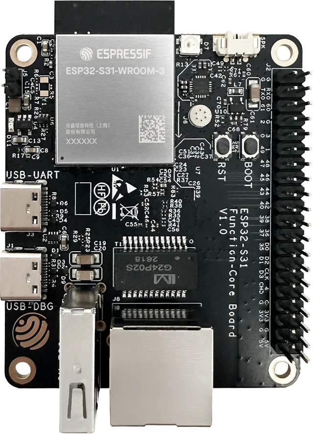

# ZHAC — Zigbee Home Automation Controller

ZHAC is an open, self-hosted **Zigbee hub on one ESP32 board**. It pairs your Zigbee
devices, runs your rules and Lua scripts on the hub itself and serves its own web UI over
Ethernet; Home Assistant (MQTT), Telegram and ZHAC Cloud are optional extras. The firmware
is [zhac-wired-core](https://github.com/zhac-project/zhac-wired-core), and it runs on either
of two boards:

- the **Espressif ESP32-S31 Function-CoreBoard**: Ethernet and the Zigbee radio on one chip
  ([below](#the-recommended-hub-esp32-s31-function-coreboard));
- the **Guition JC-ESP32P4-M3-DEV**: an ESP32-P4 with Ethernet, and the ESP32-C6 on its
  module as the Zigbee radio.

This repo (**zhac-docs**) is the entry point for the whole project: first steps, the API and
reference docs, the browser flasher and zhac.org. It is also where
[bug reports, device requests and board reports](https://github.com/zhac-project/zhac-docs/issues/new/choose)
and [Discussions](https://github.com/zhac-project/zhac-docs/discussions) live. Per-module
notes live in each module's own repo.

> **Org:** https://github.com/zhac-project

**Just want to run it?** Follow [your first 20 minutes](FIRST_20_MINUTES.md), or go straight to the
[browser flasher](https://zhac.org/flash/) — Chrome or Edge, a USB cable, no toolchain.

## The recommended hub: ESP32-S31 Function-CoreBoard

  

One Espressif board, nothing to solder or wire: Ethernet, the Zigbee radio, an RGB status LED
and USB-C are on it. It runs [zhac-wired-core](https://github.com/zhac-project/zhac-wired-core)
and talks to your network over Ethernet only (the firmware does not use the chip's Wi-Fi).

1. Connect the USB-C port labelled **USB-UART** (the upper one in the photo) to a computer and
   install from the [browser flasher](https://zhac.org/flash/#s31).
2. Plug in Ethernet and open <http://zhac.local>. The first visit asks you to set a password.
3. Later updates come from the web UI (Settings → Update) or the
   [zhac-wired-core releases](https://github.com/zhac-project/zhac-wired-core/releases).

The status LED blinks green while the join window is open and flashes blue on Zigbee traffic.

---

## Architecture

One ESP32 runs the whole hub: the Zigbee stack (Espressif's esp-zigbee-lib), the device
library ([embedded-zhc](https://github.com/zhac-project/embedded-zhc)), rules and Lua, the
REST / WebSocket / MQTT gateway and the web UI ([www-spa](https://github.com/zhac-project/www-spa)).

- **Zigbee radio:** the S31's own 802.15.4 radio; on the P4 board, the ESP32-C6 next to it,
  running Espressif's `ot_rcp` over UART.
- **Network:** Ethernet. Wi-Fi through an extra ESP32-C5 (ESP-Hosted over SPI) is in testing.
- **Clients:** the hub's web page, Home Assistant over MQTT, Telegram, and the optional ZHAC Cloud.

ZHAC started as a two-chip design: an ESP32-P4 and an ESP32-S3 joined by [HAP](HAP_PROTOCOL.md)
over SPI, with a CC2652P as the radio. It never shipped, and its repos are archived (below).

---

## Repositories

| Repo | Role | Toolchain |
|------|------|-----------|
| [zhac-wired-core](https://github.com/zhac-project/zhac-wired-core) | The hub firmware: ESP32-S31, or ESP32-P4 with an ESP32-C6 radio | ESP-IDF v6.0 (P4) / v6.1 (S31) |
| [zhac-components](https://github.com/zhac-project/zhac-components) | Shared ESP-IDF components: device store and shadow, rules, Lua engine, MQTT, WebSocket server, cloud link | ESP-IDF |
| [embedded-zhc](https://github.com/zhac-project/embedded-zhc) | Host-testable C++20 device library | CMake (host) + ESP-IDF |
| [www-spa](https://github.com/zhac-project/www-spa) | Preact + Vite web UI, packed into the firmware | Node, Vite |
| **zhac-docs** | This repo — docs, browser flasher, zhac.org, issues and Discussions | — |

**Archived** (read-only since November 2026, kept for their history):
[zhac-platform](https://github.com/zhac-project/zhac-platform) (meta-repo of the two-chip build),
[zhac-main-core](https://github.com/zhac-project/zhac-main-core) (its ESP32-P4 firmware),
[zhac-net-core](https://github.com/zhac-project/zhac-net-core) (its ESP32-S3 firmware) and
[zhac-mono-core](https://github.com/zhac-project/zhac-mono-core) (single-chip ESP32-S3,
experimental). Their shared components (`ws_server`, `remote_client`, `lua_engine`,
`lua_cjson`) moved to zhac-components with their history.

Clone over HTTPS (no SSH key needed) or SSH (`git@github.com:zhac-project/<repo>.git`).

---

## Build from source

Most people never need to: the [browser flasher](https://zhac.org/flash/) installs a release.
To build one yourself, put `zhac-components`, `embedded-zhc` and `www-spa` next to
`zhac-wired-core` and follow
[zhac-wired-core › Build from source](https://github.com/zhac-project/zhac-wired-core#build-from-source)
(ESP-IDF v6.0 for the P4, v6.1 for the S31, Node to build the web UI).

---

## Documentation

| Document | What |
|----------|------|
| [FIRST_20_MINUTES.md](FIRST_20_MINUTES.md) | From a bare board to a paired sensor and a first rule — start here |
| [TROUBLESHOOTING.md](TROUBLESHOOTING.md) | Cannot find the hub, pairing, radio, clock, lost password, updates, what a backup does not contain |
| [FEATURES.md](FEATURES.md) | Feature overview |
| [REST_API.md](REST_API.md) · [WS_API.md](WS_API.md) · [openapi.yaml](openapi.yaml) | HTTP REST + WebSocket (`/ws`) APIs |
| [MQTT_API.md](MQTT_API.md) | MQTT topics: device state, `…/set` commands, availability, rules/Lua messages — with examples |
| [HOME_ASSISTANT.md](HOME_ASSISTANT.md) | Home Assistant via MQTT discovery — setup, entities, topics |
| [RULES_DSL.md](RULES_DSL.md) | Automation rule DSL (`ON … DO … ENDON`) |
| [LUA_API.md](LUA_API.md) | Lua scripting API |
| [AUTOMATION_EXAMPLES.md](AUTOMATION_EXAMPLES.md) | Automation cookbook — worked rule + Lua examples, beginner → advanced |
| [ALARM.md](ALARM.md) | Security mode: the hub's built-in alarm panel — how it works, sensors, sirens, keypads, notifications |
| [GPIO.md](GPIO.md) | The board's own pins (Hub I/O): relays, LEDs, buttons, voltages, WS2812 strips |
| [HAP_PROTOCOL.md](HAP_PROTOCOL.md) | P4 ↔ S3 SPI binary protocol of the archived two-chip build — framing, message catalog, reliability |
| [ZNP_API_CONTRACT.md](ZNP_API_CONTRACT.md) | P4 ↔ CC2652 ZNP/MT contract of the archived two-chip build |
| [supported-devices/](supported-devices/README.md) · [search](https://zhac.org/devices/) | Supported devices by brand, and a search page |
| [VENDOR_PORTING_STATUS.md](VENDOR_PORTING_STATUS.md) | Porting status against zigbee2mqtt, for contributors |
| [SECURITY.md](SECURITY.md) · [CONTRIBUTING.md](CONTRIBUTING.md) · [CLA.md](CLA.md) | Security policy, contributing, CLA |

---

## Contributing

Anyone is welcome to open a PR.

1. Read [CLA.md](CLA.md) — signing is one-time across the whole ZHAC project.
2. Make your edit. Markdown preferred; prose over diagrams where a sentence suffices.
3. Run the link-check (`npm run lint`) locally if you add cross-document links — CI runs the same.
4. Open a PR against `master`.

## License

AGPL-3.0-or-later for the documentation prose + diagrams (see [LICENSE](LICENSE)). Code
snippets are licensed under the same terms as the code they illustrate (Apache-2.0 for
`embedded-zhc` examples, AGPL-3.0-or-later for firmware examples). Sub-repos carry their
own licenses.

## Versioning

Releases are tagged `vYYYYMMDDVV` (date + 2-digit revision). zhac-wired-core's
`release-manifest.json` pins the commit of each sibling repo a release is built from. Doc
tags may lag firmware tags — no strict coupling.
